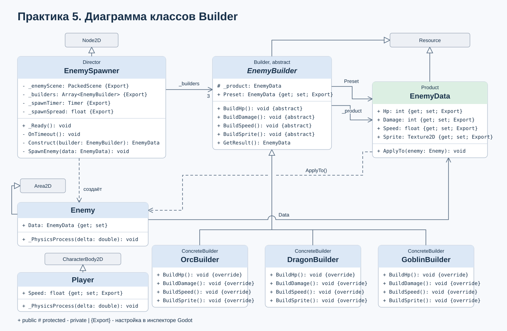

# Практика 5. Паттерн Builder в Godot

На поле сразу появляется случайный враг. Затем каждые 2 секунды появляется ещё один. Враги движутся вправо со своей скоростью и удаляются за краем экрана. Синий ромб - игрок. Для движения используй стрелки.

## Запуск

1. Установи Godot 4.7.2 .NET и .NET SDK 10.
2. Импортируй `project.godot` в менеджере проектов Godot .NET.
3. Открой проект и нажми F5. Основная сцена - `GameField.tscn`.

## Компоненты проекта

- `EnemyData` - продукт. Хранит здоровье, урон, скорость и текстуру. Метод `ApplyTo` передаёт данные врагу и задаёт текстуру его спрайта.
- `EnemyBuilder` - абстрактный строитель. Объявляет шаги сборки. После вызова `GetResult` строитель начинает работу со свежим набором данных.
- `OrcBuilder`, `DragonBuilder`, `GoblinBuilder` - конкретные строители. Каждый заполняет четыре характеристики из своего пресета.
- `EnemySpawner` - директор. Случайно выбирает строителя, вызывает шаги сборки в одном порядке, создаёт экземпляр сцены врага и применяет результат.
- `Enemy.tscn` и `Enemy.cs` - общая сцена и скрипт врага. В сцене есть спрайт, форма коллизии и узел, который отслеживает выход за экран.
- `Player.cs` - управление игроком. Скорость можно изменить в инспекторе на узле `Player`.
- `GameField.tscn` - игровое поле с игроком, спавнером, таймером и настройками трёх врагов.

## Настройки врагов

| Враг | HP | Урон | Скорость, пикселей в секунду | Спрайт |
| --- | ---: | ---: | ---: | --- |
| Орк | 30 | 12 | 150 | Зелёный |
| Дракон | 200 | 45 | 80 | Коралловый |
| Гоблин | 20 | 8 | 210 | Сиреневый |

Характеристики можно изменить через ресурсы `Preset` в массиве `Builders` на узле `EnemySpawner`. Интервал задаётся в `Wait Time` узла `SpawnTimer`.

## UML-диаграмма классов

[Открыть диаграмму в полном размере](docs/UML.svg)
